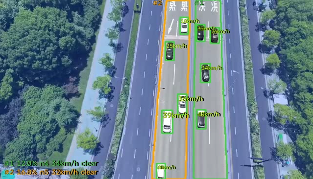

# drone-vision

无人机俯视视角下的高架车流分析：分割高架路面 → 其余区域涂黑 → 在涂黑图上检测车辆与车道线 → ByteTrack 追踪 → 按每个高架实体统计**密度、平均车速、拥挤度**。仓库同时包含一套本地演示平台（MediaMTX + Vue + FastAPI + worker 容器）。

## 效果



- 蓝色半透明：高架**外**区域；高架内部不涂色。
- 绿色 `#1` / 橙色 `#2`：两块高架实体，轮廓、`#N` 标签与左下角统计三者同色。
- 车框里的 `km/h`：只标给测出速度的车，没有速度的车不画。
- 左下角每块板一行：密度（像素覆盖率）、车数 `n`、平均车速、拥挤度（`clear` / `moderate` / `severe`）。

## 目录

```text
worker/                算法主体（uv 项目 + Dockerfile）
  src/algorithm/domain/      契约 + 状态机（车辆地速、每板密度/均速/拥挤度）
  src/algorithm/perception/  模型适配、ByteTrack、deck 追踪、pipeline
  src/algorithm/runtime/     帧源（文件/RTSP）、RTMP 推流、JSONL 快照、组合根
  src/drone_worker/          batch / relay 两个入口、分发、渲染
backend/               控制 API（FastAPI + Docker SDK / 本地进程模式）
frontend/              Vue 3 + Vite + nginx
deploy/mediamtx/       MediaMTX 配置
docker-compose.yml     本地演示平台编排
```

## 本地跑 worker

需要先放权重（不入库）：

- `worker/models/viaduct/weights/best.pt`：segment，单类 `viaduct`
- `worker/models/vehicle/weights/best.pt`：detect，单类 `car`
- `worker/models/line/weights/best.pt`：detect，单类 `line`

```powershell
cd worker
$env:PYTHONPATH="E:\Pycharm\drone-vision\worker\src"
"D:\Software\Anaconda3\envs\pytorch\python.exe" -m drone_worker --source videos\video1_1080P.mp4
```

默认输出到 `worker/output/`：`<视频名>.jsonl`（每帧一条 Observation，默认开）和 `<视频名>_pipeline.mp4`（仅 `--save-video`）。`--project <dir>` 改输出目录，`--no-save-json` 关闭 JSONL。模型尺寸、置信度等调参项在 [`worker/config/pipeline.yaml`](worker/config/pipeline.yaml)。参数、数据结构与各 runtime 的判定规则见 [worker/README.md](worker/README.md)。

## 测试

```powershell
cd worker
$env:PYTHONPATH="E:\Pycharm\drone-vision\worker\src"
"D:\Software\Anaconda3\envs\pytorch\python.exe" -m pytest tests -q
```

82 个测试，纯 CPU，不需要权重和视频。

## 一键跑通（Docker）

前置：WSL2 里的 Docker + Compose、Windows 侧的 FFmpeg、`assets/drone.mp4`、`worker/models/` 下的三个权重。

```bash
# 1. WSL：起平台（首次会构建 worker/backend/frontend 三个镜像，worker 镜像较大）
docker compose up -d --build
docker compose ps
```

```powershell
# 2. Windows：推流（循环推 assets\drone.mp4 到 drone1）
powershell -ExecutionPolicy Bypass -File scripts\push-windows.ps1
```

打开 <http://localhost:8080>，点「启动算法」——backend 启动 worker 容器，worker 拉 `drone1`、推理、把标注流推回 `drone1_yolo`，页面自动切到检测画面；点「停止算法」回到原画。

worker 容器的行为：

| 挂载 | 容器路径 |
| --- | --- |
| `worker/models` | `/app/models`（只读） |
| `worker/videos` | `/app/videos`（只读） |
| `worker/output` | `/app/output` |

```yaml
command: relay --source ${DRONE_SOURCE:-rtsp://127.0.0.1:8554/drone1} \
               --dest   ${DRONE_DEST:-rtmp://127.0.0.1:1935/drone1_yolo} \
               --device ${WORKER_DEVICE:-0}
```

实时链路需要 GPU：pipeline 得跑到几 fps，轨迹才能跨帧接上。容器里用 GPU 要按 `docker-compose.yml` 的注释打开 `deploy.resources.reservations.devices`（需 NVIDIA Container Toolkit）；拿不到 GPU 时 relay 会自动退回 CPU，但 CPU 实测约 1 fps，只出画面不出速度，仅作兜底。

## 不构建，直接在本机联调

只用一个 MediaMTX 容器（镜像，不构建），worker / backend / frontend 全部原生跑：

```bash
# 1) WSL：只起 MediaMTX（和平时一样走 host 网络）
cd /path/to/drone-vision && docker compose up -d mediamtx
```

```powershell
# 2) Windows：推流
powershell -ExecutionPolicy Bypass -File scripts\push-windows.ps1

# 3) Windows：后端（进程模式，直接拉起 worker relay）
cd E:\Pycharm\drone-vision\backend
$env:WORKER_MODE="process"
$env:WORKER_PYTHON="D:\Software\Anaconda3\envs\pytorch\python.exe"
$env:WORKER_WORKDIR="E:\Pycharm\drone-vision\worker"
$env:WORKER_PYTHONPATH="E:\Pycharm\drone-vision\worker\src"
$env:WORKER_ARGS="relay --source rtsp://127.0.0.1:8554/drone1 --dest rtmp://127.0.0.1:1935/drone1_yolo --device 0"
uv run uvicorn app.main:app --host 127.0.0.1 --port 8000

# 4) Windows：前端 dev（/api 代理到 8000，WHEP 直连 8889）
cd E:\Pycharm\drone-vision\frontend
npm install     # 已有 node_modules 可跳过
npm run dev
```

打开 <http://127.0.0.1:5173>，点「启动算法」即由 backend 以子进程方式启动 `python -m drone_worker relay ...`；停止时 terminate 该进程。

只想验证 relay 本身，可以绕过平台：

```powershell
cd E:\Pycharm\drone-vision\worker
$env:PYTHONPATH="E:\Pycharm\drone-vision\worker\src"
"D:\Software\Anaconda3\envs\pytorch\python.exe" -m drone_worker relay `
  --source rtsp://127.0.0.1:8554/drone1 --dest rtmp://127.0.0.1:1935/drone1_yolo --device 0
```

检测流随后可在 <http://127.0.0.1:8889/drone1_yolo> 直接播放（也可以把 `--source` 换成本地 mp4，relay 会按帧率回放并循环）。

## 当前状态

- 已完成：分割 / 检测 / 追踪、每板密度 + 平均车速 + 拥挤度、JSONL、标注视频、批处理 CLI、**实时 relay（RTSP→RTMP）**、82 个测试、worker / backend / frontend 镜像与 compose、backend 的容器 / 本地进程两种 worker 模式。
- 未完成：worker 的 GPU 容器配置默认关闭（需手动打开 `deploy` 段）；平台没有历史录像 / 回放界面。

## 安全说明

`backend` 挂载了 `/var/run/docker.sock`，等于拥有宿主机 Docker 控制权。本项目只用于本机演示，不要把 compose 直接暴露到公网。
